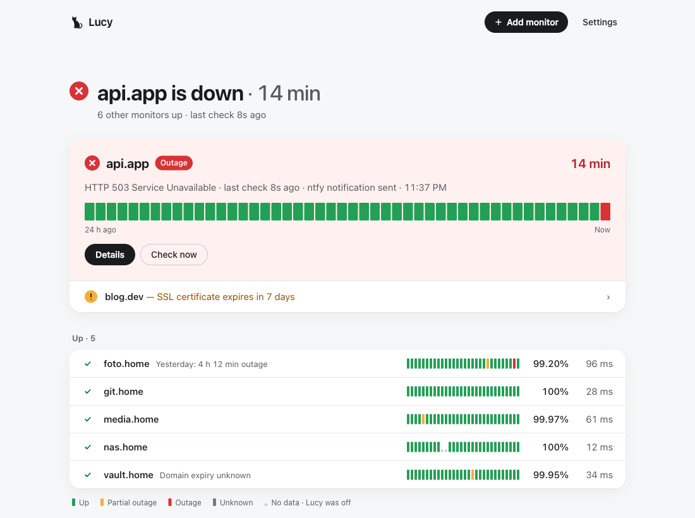
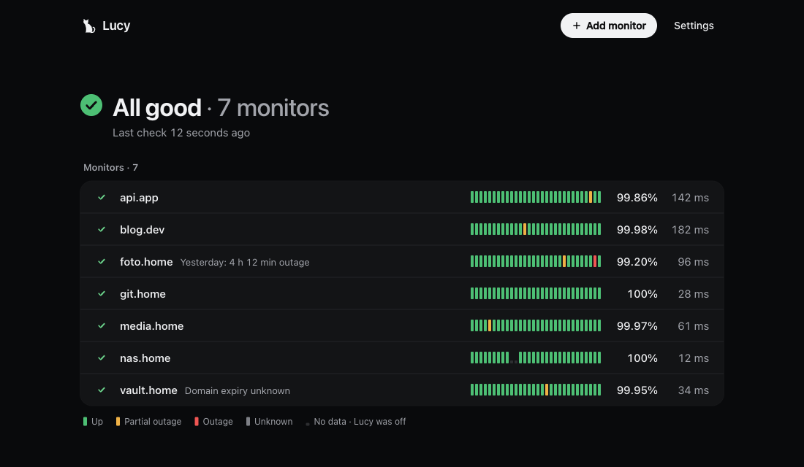
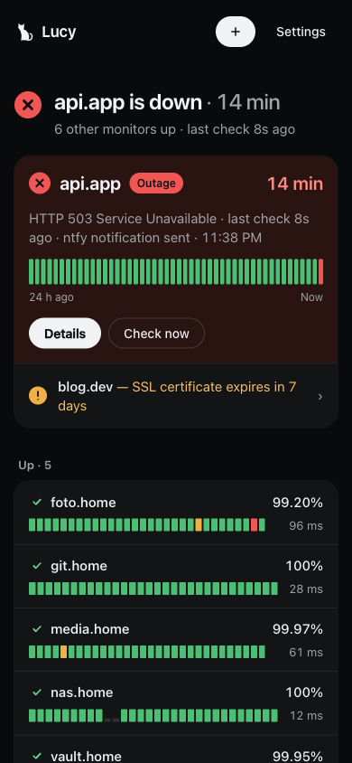

<p align="center">
  
</p>

<h1 align="center">Lucy</h1>

<p align="center">
  A calm, self-hosted uptime monitor for your home server.<br>
  HTTP checks, SSL and domain expiry, and phone alerts through <a href="https://ntfy.sh">ntfy</a>.
</p>

<p align="center">
  <a href="LICENSE"></a>
  
  
</p>

<p align="center">
  
</p>

Most of the time you open Lucy for a few seconds to answer one question: *is everything OK?* So the
interface stays quiet when nothing is wrong, and puts the broken monitor front and center when
something is.

Lucy is a single-user app that runs as one small container with an embedded SQLite database. There
is no account system, no public status page and no external services besides the ntfy server you
choose.

## Features

- **HTTP(S) monitors** with GET, POST, PUT or HEAD, custom headers and request body, a timeout, and
  a check interval of 30 seconds, 1, 5 or 15 minutes.
- **Conditions** that must all hold for a monitor to count as up: status code range, response time,
  body contains or does not contain, and JSON path equals or contains (for example `$.status`).
- **Alert threshold**: notify only after 1–10 failed checks in a row, so a single blip stays quiet.
- **SSL certificate and domain expiry**: warnings 14 and 7 days ahead and when they expire. Domain
  dates come from RDAP; local names such as `.home` are reported as unknown.
- **ntfy notifications** for outages, recoveries and expiry warnings, with buttons that open the
  monitor in Lucy or the site itself. Mark a monitor as **urgent** and its outage alerts ring through
  Do Not Disturb.
- **Knows when your internet is down.** If Lucy loses its own connection, checks to outside sites are
  marked *unknown* instead of *down*, notifications wait in a queue, and local monitors keep working.
- **Honest history.** Time when Lucy itself was not running is shown as *no data* and is left out of
  uptime percentages.
- **Monitor details**: uptime for 24 hours, 7 and 30 days, a response time chart with outage bands,
  the last check result and a 30-day event timeline.
- **Test before saving**: run a single check from the editor and see which conditions pass.
- **YAML backup**: export and import monitors and notification settings. The ntfy token is never
  written to the file, and imports show a preview first.
- English and Turkish interface, light, dark and system themes, and a layout that works on a phone.

<p align="center">
  
  
</p>

## Quick start

You need Docker with the Compose plugin. Run Lucy on a different machine from the services it
watches: if that machine goes down, Lucy goes down with it and cannot tell you.

```bash
git clone https://github.com/zeybekserdar/lucy.git
cd lucy
cp .env.example .env
```

Pick an ntfy topic and put it in `.env`. Topics on ntfy.sh are public, so use a name nobody can
guess:

```bash
openssl rand -hex 12
```

Subscribe to the same topic in the ntfy app on your phone, then start Lucy:

```bash
docker compose up -d --build
```

Open `http://your-server:8080` right away and set your password. Until a password is set, whoever
opens the page first can set it.

The ntfy values in `.env` are only read on first start. After that, change them under **Settings**,
where you can also send a test notification.

## Configuration

Docker Compose reads these from `.env`:

| Variable | Default | Description |
| --- | --- | --- |
| `LUCY_NTFY_TOPIC` | | ntfy topic for notifications. First start only. |
| `LUCY_NTFY_SERVER` | `https://ntfy.sh` | Your own ntfy server, if you run one. First start only. |
| `LUCY_NTFY_TOKEN` | | Access token for a protected ntfy server. First start only. |
| `LUCY_PUBLIC_URL` | | Address your phone uses to reach Lucy, such as `http://192.168.1.10:8080`. Used for notification links and the icon. The value in Settings takes precedence. |
| `LUCY_LANG` | `en` | Language of notification texts: `en` or `tr`. The interface language is chosen in Settings. |
| `LUCY_PORT` | `8080` | Port published on the host. |
| `TZ` | `Europe/Istanbul` | Time zone for day boundaries and times in notifications. |

Lower-level settings for running the binary yourself:

| Variable | Default | Description |
| --- | --- | --- |
| `LUCY_ADDR` | `127.0.0.1:8080` | Listen address. The container uses `0.0.0.0:8080`. |
| `LUCY_DB` | `data/lucy.db` | SQLite database path. The container uses `/data/lucy.db`. |
| `LUCY_PROBE_TARGETS` | `1.1.1.1:443,8.8.8.8:443` | Addresses Lucy dials to tell whether its own internet is up. |

## Notifications

Lucy sends four kinds of notifications to ntfy: an outage, a recovery with how long it lasted, an
upcoming SSL or domain expiry, and an expired certificate or domain. Messages are queued in the
database and retried with backoff, so a short ntfy or network problem does not lose them.

- **Links.** With a Lucy address set, tapping a notification opens that monitor in Lucy, and the
  notification carries *Open in Lucy* and *Open site* buttons.
- **Icon.** Notifications point ntfy at Lucy's own icon. The ntfy Android app shows it when the phone
  can reach your Lucy address; the iOS app always shows the ntfy icon.
- **Urgent monitors** send outages at ntfy's highest priority, which can break through Do Not Disturb.
  Whether it does depends on the ntfy app and your phone's settings.

## Operating Lucy

**Update** to a newer version. Data is kept and the database migrates itself:

```bash
git pull
docker compose up -d --build
```

**Back up** your monitors and notification settings with **Settings → Export**. For a full backup
that includes history, stop Lucy and copy the database volume:

```bash
docker compose stop
docker run --rm -v lucy_lucy-data:/data:ro -v "$PWD":/backup alpine tar czf /backup/lucy-backup.tgz -C /data .
docker compose start
```

The `lucy_` prefix of the volume name comes from the folder name; check with `docker volume ls`.

**Forgot your password?** Reset it from the server:

```bash
docker exec -it lucy lucy reset-password
```

**Retention.** Individual checks are kept for 30 days and half-hourly summaries for a year.

## Security

- Lucy does not serve HTTPS. To reach it from outside your home network, put it behind a VPN such as
  Tailscale or a reverse proxy that terminates TLS.
- Passwords are hashed with Argon2id, login attempts are rate limited, and changing the password ends
  all other sessions.
- The container runs as a non-root user on a read-only file system with all capabilities dropped.

See [SECURITY.md](SECURITY.md) for how to report a vulnerability.

## Development

Lucy is a Go backend with a React, TypeScript and Vite interface. In production the interface is
embedded into the Go binary; in development Vite serves it and proxies `/api` to Go.

Requirements: Go 1.27 and Node.js 24.

```bash
# Terminal 1: API on http://127.0.0.1:8080, database in data/lucy.db
go run ./cmd/lucy

# Terminal 2: interface on http://localhost:5173
npm --prefix web install
npm --prefix web run dev
```

Add `?state=ok`, `incident`, `offline`, `empty` or `error` to the address to see the interface with
sample data and no backend. The screenshots in this README were taken that way.

Run the tests and checks:

```bash
go test ./...
npm --prefix web test
npm --prefix web run lint
npm --prefix web run build
```

### Project layout

```
cmd/lucy/          entry point and the reset-password command
internal/alert/    up/down state machine and expiry warning stages
internal/api/      HTTP API, authentication and backups
internal/auth/     password hashing, sessions and login throttling
internal/checker/  HTTP checks, conditions, TLS, RDAP and internet detection
internal/notify/   notification texts and the ntfy delivery queue
internal/scheduler/ runs checks on each monitor's interval
internal/store/    SQLite storage, migrations and history rollups
internal/yamlio/   YAML backup format
web/               React interface
```

## Contributing

Bug reports, ideas and pull requests are welcome. Please read [CONTRIBUTING.md](CONTRIBUTING.md)
first, and note that this project follows a [Code of Conduct](CODE_OF_CONDUCT.md).

## License

Lucy is licensed under the [Apache License 2.0](LICENSE).

Lucy is named after a black cat, who also posed for the logo.
